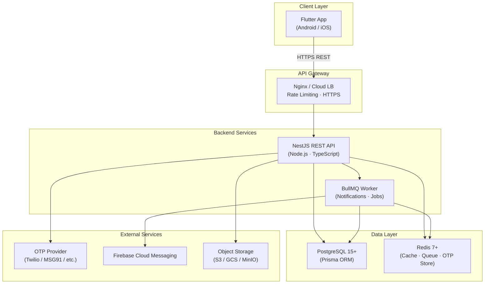
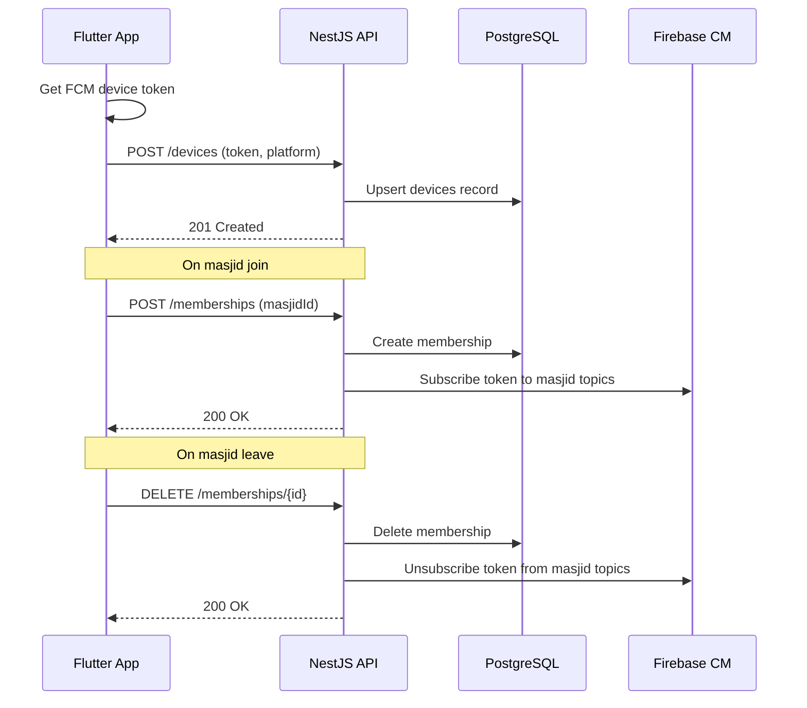

# Architecture — Masjid Management & Namaz Time

## 1. System Overview



## 2. Module List

| Module | Layer | Description |
|--------|-------|-------------|
| **Auth** | Backend + App | Mobile OTP login, JWT access/refresh tokens, session management |
| **Users** | Backend + App | Profile CRUD, language preference, avatar |
| **Masjids** | Backend + App | Masjid registration, details, photo, location, search, QR |
| **Memberships** | Backend + App | Join/leave masjid, QR scan join, member listing |
| **Prayer Times** | Backend + App | Daily 5-prayer jamaah times (admin-entered), display & caching |
| **Special Schedules** | Backend + App | Ramzan timetable, Eid/Jummah/Taraweeh/Tahajjud schedules |
| **Announcements** | Backend + App | Categorized announcements with push notification dispatch |
| **Sandha (Dues)** | Backend + App | Plans, payment tracking, auto-link by phone, reports |
| **Notifications** | Backend + App | FCM topic management, device registration, preference toggles |
| **Qibla** | App only | Compass-based Qibla direction (device sensor, no backend) |
| **Admin Dashboard** | App | Masjid management screens for Admin role |
| **Super Admin Dashboard** | App + Backend | Multi-masjid overview, analytics, user/masjid management |
| **Core / Shared** | Both | Error handling, guards, interceptors, base widgets, theming |

## 3. Tech Stack Decisions

| Concern | Choice | Rationale |
|---------|--------|-----------|
| **Mobile framework** | Flutter 3.x (Material 3) | Single codebase for Android + iOS; Material 3 gives polished, accessible UI out of the box; large package ecosystem for sensors (Qibla compass) and QR scanning. |
| **State management** | Riverpod 2.x | Compile-safe, testable, supports code-gen; superior to Provider for complex dependency graphs (auth state → membership state → prayer times). |
| **Routing** | go_router | Declarative, deep-link friendly, integrates with Riverpod for auth-guarded routes. |
| **Backend framework** | NestJS (Node.js + TypeScript) | Modular architecture maps 1:1 to our domain modules; decorators for guards/roles simplify RBAC; large middleware ecosystem. |
| **ORM** | Prisma 5.x | Type-safe queries generated from schema; migrations are declarative and reviewable; introspection tooling. |
| **Database** | PostgreSQL 15+ | JSONB for flexible metadata, excellent indexing, proven at scale, free. |
| **Cache / Queue** | Redis 7+ | In-memory speed for OTP store (TTL-based expiry), response caching, and BullMQ job queue backing. |
| **Job queue** | BullMQ | Redis-backed; handles notification fan-out, scheduled prayer-time reminders, sandha payment reminders. Runs as a separate worker process for reliability. |
| **Push notifications** | Firebase Cloud Messaging | Free, reliable, supports topics (one topic per masjid for broadcast). |
| **Object storage** | S3-compatible (AWS S3 / GCS / MinIO) | Masjid photos, QR code images. MinIO for self-hosted/dev parity. |
| **OTP provider** | Abstracted (Twilio default) | Interface-based; swap to MSG91 / Kaleyra for India-specific cost savings without code changes. |
| **Localization** | flutter_localizations + ARB files | Built-in Flutter i18n for Tamil + English. |

## 4. Offline Caching Strategy

### What Gets Cached

| Data | Storage | TTL | Sync Strategy |
|------|---------|-----|---------------|
| **Prayer times** (current week) | SQLite (Drift) | 24 hours | Pull on app open; background refresh via WorkManager every 6h. If offline, show cached. |
| **Joined masjid list** | SQLite | 1 hour | Pull on app open. Stale data acceptable for read; join/leave requires network. |
| **Masjid details** | SQLite | 24 hours | Pull on navigation to masjid page; force-refresh on pull-down. |
| **Announcements** (last 20) | SQLite | 30 minutes | Pull on tab open + push notification triggers re-fetch. |
| **User profile** | SQLite | Until logout | Write-through on edit. |
| **Qibla data** | None | N/A | Pure device sensor; no network needed. |
| **Sandha payment history** | Not cached | — | Always fetched live (sensitive financial data). |
| **Auth tokens** | flutter_secure_storage | Until expiry/logout | Refresh token used to obtain new access token silently. |

### Sync Approach

```
App Open → Check network
  ├─ Online  → Fetch fresh data, update local DB, render
  └─ Offline → Render from local DB, show "Offline" banner
                On reconnect → trigger sync for stale data
```

- **Conflict resolution**: Server wins (last-write-wins). Users don't edit shared data offline.
- **Stale indicator**: UI shows a subtle "Last updated: X minutes ago" label when data age > TTL.
- **Cache eviction**: On logout, all cached data is wiped. On masjid leave, that masjid's cached data is removed.

## 5. Push Notification Approach

### FCM Topic Architecture

```
Topic naming:  masjid_{masjidId}_all          → all announcements
               masjid_{masjidId}_emergency    → emergency only
               masjid_{masjidId}_prayer       → prayer time changes
               global_all                     → super admin broadcasts
```

### Device Token Registration Flow



### Notification Preferences

Users can toggle per-masjid:
- **All announcements** (on/off)
- **Prayer time changes** (on/off)
- **Emergency alerts** (always on, cannot disable)
- **Sandha reminders** (on/off)

Preferences stored in `notification_prefs` table. Backend checks prefs before dispatching via BullMQ worker.

### Notification Payload Structure

```json
{
  "topic": "masjid_uuid_all",
  "notification": {
    "title": "Masjid Al-Huda",
    "body": "Maghrib jamaah time changed to 6:45 PM"
  },
  "data": {
    "type": "PRAYER_CHANGE",
    "masjidId": "uuid",
    "deepLink": "/masjid/uuid/prayer-times"
  }
}
```

## 6. OTP Provider Abstraction

```typescript
// Core interface — any provider must implement this
export interface OtpProvider {
  sendOtp(phoneNumber: string, otp: string, locale: 'en' | 'ta'): Promise<OtpSendResult>;
  verifyOtp?(phoneNumber: string, otp: string): Promise<boolean>; // optional: some providers verify server-side
}

export interface OtpSendResult {
  success: boolean;
  providerRef: string;      // provider's message ID for debugging
  expiresInSeconds: number;
}

// Concrete implementations
export class TwilioOtpProvider implements OtpProvider { /* ... */ }
export class Msg91OtpProvider implements OtpProvider { /* ... */ }

// Factory — selected via environment variable OTP_PROVIDER
export class OtpProviderFactory {
  static create(provider: string): OtpProvider {
    switch (provider) {
      case 'twilio': return new TwilioOtpProvider();
      case 'msg91':  return new Msg91OtpProvider();
      default:       return new ConsoleOtpProvider(); // dev: logs OTP to console
    }
  }
}
```

**OTP Flow**:
1. Backend generates a 6-digit OTP.
2. OTP is stored in Redis with key `otp:{phone}`, TTL = 5 minutes.
3. Provider sends SMS.
4. On verify: compare submitted OTP with Redis value. Max 5 attempts, then invalidate.
5. Rate limit: max 3 OTP requests per phone per 15 minutes.

## 7. API Versioning Strategy

| Decision | Detail |
|----------|--------|
| **Method** | URI prefix versioning: `/api/v1/...` |
| **Rationale** | Simplest to implement, debug, and document. Avoids header-based complexity. Clear in logs and monitoring. |
| **Breaking change policy** | New major version (`v2`) only when request/response shapes change incompatibly. Additive changes (new optional fields) are non-breaking within `v1`. |
| **Deprecation** | Old version supported for 6 months after new version launch. `Sunset` header added to deprecated responses. |
| **Implementation** | NestJS `@Controller('v1/resource')` — each version is a separate controller if needed; shared service layer. |

## 8. Error Handling Format

### Standard JSON Error Envelope

```json
{
  "success": false,
  "error": {
    "code": "VALIDATION_ERROR",
    "message": "Phone number is required",
    "details": [
      {
        "field": "phone",
        "constraint": "isNotEmpty",
        "message": "phone should not be empty"
      }
    ],
    "timestamp": "2024-01-15T10:30:00.000Z",
    "path": "/api/v1/auth/request-otp",
    "requestId": "req_abc123"
  }
}
```

### Standard Success Envelope

```json
{
  "success": true,
  "data": { ... },
  "meta": {
    "page": 1,
    "limit": 20,
    "total": 150,
    "totalPages": 8
  }
}
```

### Error Code Catalog

| HTTP Status | Error Code | When |
|-------------|-----------|------|
| 400 | `VALIDATION_ERROR` | Request body / query param validation fails |
| 401 | `UNAUTHORIZED` | Missing or invalid JWT |
| 401 | `OTP_EXPIRED` | OTP TTL exceeded |
| 401 | `OTP_INVALID` | Wrong OTP code |
| 403 | `FORBIDDEN` | Valid JWT but insufficient role/permission |
| 404 | `NOT_FOUND` | Resource does not exist |
| 409 | `CONFLICT` | Duplicate (e.g., already a member) |
| 422 | `UNPROCESSABLE` | Semantically invalid (e.g., end time before start time) |
| 429 | `RATE_LIMITED` | Too many requests (OTP, API calls) |
| 500 | `INTERNAL_ERROR` | Unhandled server error (details hidden in production) |

### Implementation

- **NestJS Global Exception Filter** catches all exceptions and formats them into the envelope.
- **Request ID** (`X-Request-Id` header) generated per request for tracing.
- **Validation** via `class-validator` decorators on DTOs; pipe transforms validation errors into the standard format.
- **Logging**: All 5xx errors logged with full stack trace + request ID. 4xx errors logged at `warn` level.
