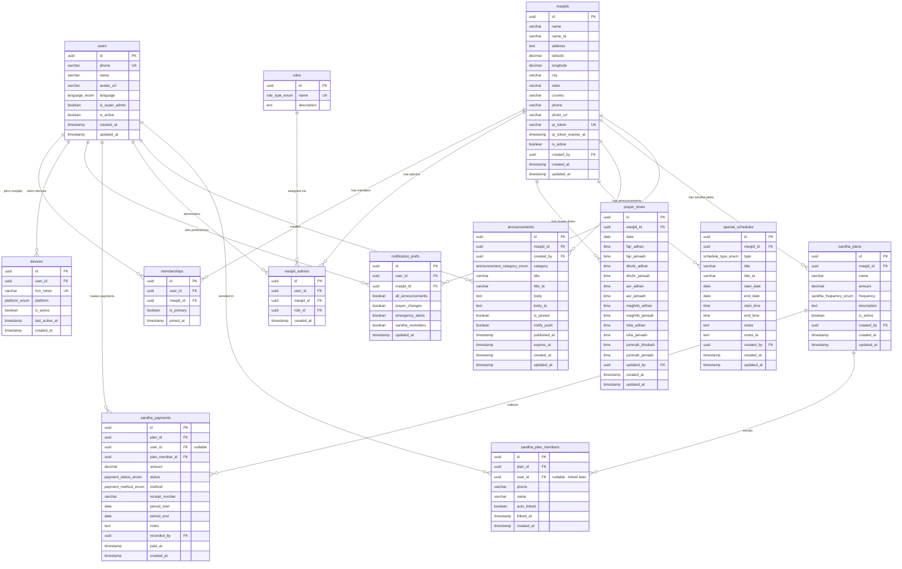

# Database Schema — Masjid Management & Namaz Time

## 1. Entity-Relationship Diagram



## 2. Table Definitions

### 2.1 `users`

| Column | Type | Constraints | Description |
|--------|------|-------------|-------------|
| `id` | UUID | PK, DEFAULT gen_random_uuid() | Unique user identifier |
| `phone` | VARCHAR(20) | UNIQUE, NOT NULL | Mobile number with country code (e.g., +919876543210) |
| `name` | VARCHAR(100) | NOT NULL | Display name |
| `avatar_url` | VARCHAR(500) | NULLABLE | Profile photo URL in object storage |
| `language` | language_enum | NOT NULL, DEFAULT 'en' | Preferred language |
| `is_super_admin` | BOOLEAN | NOT NULL, DEFAULT false | Super admin flag |
| `is_active` | BOOLEAN | NOT NULL, DEFAULT true | Soft-delete / suspension flag |
| `created_at` | TIMESTAMPTZ | NOT NULL, DEFAULT now() | Account creation time |
| `updated_at` | TIMESTAMPTZ | NOT NULL, DEFAULT now() | Last profile update |

**Indexes**:
- `idx_users_phone` — UNIQUE on `phone`
- `idx_users_is_super_admin` — partial index WHERE `is_super_admin = true`

---

### 2.2 `masjids`

| Column | Type | Constraints | Description |
|--------|------|-------------|-------------|
| `id` | UUID | PK, DEFAULT gen_random_uuid() | Unique masjid identifier |
| `name` | VARCHAR(200) | NOT NULL | Masjid name (English) |
| `name_ta` | VARCHAR(200) | NULLABLE | Masjid name (Tamil) |
| `address` | TEXT | NOT NULL | Full address |
| `latitude` | DECIMAL(10,8) | NULLABLE | GPS latitude |
| `longitude` | DECIMAL(11,8) | NULLABLE | GPS longitude |
| `city` | VARCHAR(100) | NOT NULL | City |
| `state` | VARCHAR(100) | NULLABLE | State / province |
| `country` | VARCHAR(100) | NOT NULL, DEFAULT 'India' | Country |
| `phone` | VARCHAR(20) | NULLABLE | Masjid contact number |
| `photo_url` | VARCHAR(500) | NULLABLE | Masjid photo URL |
| `qr_token` | VARCHAR(64) | UNIQUE, NOT NULL | Join token embedded in QR code |
| `qr_token_expires_at` | TIMESTAMPTZ | NULLABLE | NULL = permanent token |
| `is_active` | BOOLEAN | NOT NULL, DEFAULT true | Active status |
| `created_by` | UUID | FK → users(id), NOT NULL | User who registered the masjid |
| `created_at` | TIMESTAMPTZ | NOT NULL, DEFAULT now() | Registration time |
| `updated_at` | TIMESTAMPTZ | NOT NULL, DEFAULT now() | Last update |

**Indexes**:
- `idx_masjids_qr_token` — UNIQUE on `qr_token`
- `idx_masjids_city` — on `city` for search
- `idx_masjids_location` — on `(latitude, longitude)` for geo queries
- `idx_masjids_name_trgm` — GIN trigram index on `name` for fuzzy search

---

### 2.3 `roles`

| Column | Type | Constraints | Description |
|--------|------|-------------|-------------|
| `id` | UUID | PK, DEFAULT gen_random_uuid() | Role identifier |
| `name` | role_type_enum | UNIQUE, NOT NULL | Role name |
| `description` | TEXT | NULLABLE | Human-readable description |

Pre-seeded with: `SUPER_ADMIN`, `ADMIN`, `FINANCE`, `ANNOUNCEMENT`.

---

### 2.4 `masjid_admins`

| Column | Type | Constraints | Description |
|--------|------|-------------|-------------|
| `id` | UUID | PK, DEFAULT gen_random_uuid() | Record identifier |
| `user_id` | UUID | FK → users(id), NOT NULL | The admin user |
| `masjid_id` | UUID | FK → masjids(id), NOT NULL | The masjid they administer |
| `role_id` | UUID | FK → roles(id), NOT NULL | Their role for this masjid |
| `created_at` | TIMESTAMPTZ | NOT NULL, DEFAULT now() | Assignment time |

**Indexes**:
- `idx_masjid_admins_unique` — UNIQUE on `(user_id, masjid_id, role_id)`
- `idx_masjid_admins_masjid` — on `masjid_id`

**Note**: One user can have the ADMIN role for multiple masjids (separate rows).

---

### 2.5 `memberships`

| Column | Type | Constraints | Description |
|--------|------|-------------|-------------|
| `id` | UUID | PK, DEFAULT gen_random_uuid() | Record identifier |
| `user_id` | UUID | FK → users(id), NOT NULL | Member user |
| `masjid_id` | UUID | FK → masjids(id), NOT NULL | Joined masjid |
| `is_primary` | BOOLEAN | NOT NULL, DEFAULT false | User's primary masjid (for default prayer times display) |
| `joined_at` | TIMESTAMPTZ | NOT NULL, DEFAULT now() | Join timestamp |

**Indexes**:
- `idx_memberships_unique` — UNIQUE on `(user_id, masjid_id)`
- `idx_memberships_masjid` — on `masjid_id`
- `idx_memberships_primary` — partial index WHERE `is_primary = true`

---

### 2.6 `prayer_times`

| Column | Type | Constraints | Description |
|--------|------|-------------|-------------|
| `id` | UUID | PK, DEFAULT gen_random_uuid() | Record identifier |
| `masjid_id` | UUID | FK → masjids(id), NOT NULL | Masjid these times belong to |
| `date` | DATE | NOT NULL | The date for these times |
| `fajr_adhan` | TIME | NULLABLE | Fajr adhan time |
| `fajr_jamaah` | TIME | NOT NULL | Fajr jamaah time |
| `dhuhr_adhan` | TIME | NULLABLE | Dhuhr adhan time |
| `dhuhr_jamaah` | TIME | NOT NULL | Dhuhr jamaah time |
| `asr_adhan` | TIME | NULLABLE | Asr adhan time |
| `asr_jamaah` | TIME | NOT NULL | Asr jamaah time |
| `maghrib_adhan` | TIME | NULLABLE | Maghrib adhan time |
| `maghrib_jamaah` | TIME | NOT NULL | Maghrib jamaah time |
| `isha_adhan` | TIME | NULLABLE | Isha adhan time |
| `isha_jamaah` | TIME | NOT NULL | Isha jamaah time |
| `jummah_khutbah` | TIME | NULLABLE | Friday khutbah start (Friday only) |
| `jummah_jamaah` | TIME | NULLABLE | Friday jamaah time |
| `updated_by` | UUID | FK → users(id), NOT NULL | Admin who set/updated the times |
| `created_at` | TIMESTAMPTZ | NOT NULL, DEFAULT now() | Record creation |
| `updated_at` | TIMESTAMPTZ | NOT NULL, DEFAULT now() | Last update |

**Indexes**:
- `idx_prayer_times_unique` — UNIQUE on `(masjid_id, date)`
- `idx_prayer_times_date_range` — on `(masjid_id, date)` for range queries

**Design note**: Times are stored as TIME type (local masjid time), not TIMESTAMPTZ, because prayer times are inherently local. The backend converts to the user's display timezone only if the user is in a different timezone (rare edge case). The `date` column determines the day. Adhan times are optional because many masjids only announce jamaah times.

---

### 2.7 `special_schedules`

| Column | Type | Constraints | Description |
|--------|------|-------------|-------------|
| `id` | UUID | PK, DEFAULT gen_random_uuid() | Record identifier |
| `masjid_id` | UUID | FK → masjids(id), NOT NULL | Masjid |
| `type` | schedule_type_enum | NOT NULL | Schedule category |
| `title` | VARCHAR(200) | NOT NULL | Title (English) |
| `title_ta` | VARCHAR(200) | NULLABLE | Title (Tamil) |
| `start_date` | DATE | NOT NULL | Schedule start date |
| `end_date` | DATE | NULLABLE | End date (NULL = single day) |
| `start_time` | TIME | NOT NULL | Start time |
| `end_time` | TIME | NULLABLE | End time |
| `notes` | TEXT | NULLABLE | Additional notes (English) |
| `notes_ta` | TEXT | NULLABLE | Additional notes (Tamil) |
| `created_by` | UUID | FK → users(id), NOT NULL | Creator |
| `created_at` | TIMESTAMPTZ | NOT NULL, DEFAULT now() | Creation time |
| `updated_at` | TIMESTAMPTZ | NOT NULL, DEFAULT now() | Last update |

**Indexes**:
- `idx_special_schedules_masjid_dates` — on `(masjid_id, start_date, end_date)`
- `idx_special_schedules_type` — on `(masjid_id, type)`

---

### 2.8 `announcements`

| Column | Type | Constraints | Description |
|--------|------|-------------|-------------|
| `id` | UUID | PK, DEFAULT gen_random_uuid() | Record identifier |
| `masjid_id` | UUID | FK → masjids(id), NOT NULL | Masjid |
| `created_by` | UUID | FK → users(id), NOT NULL | Author (admin or announcement role) |
| `category` | announcement_category_enum | NOT NULL | Announcement type |
| `title` | VARCHAR(300) | NOT NULL | Title (English) |
| `title_ta` | VARCHAR(300) | NULLABLE | Title (Tamil) |
| `body` | TEXT | NOT NULL | Body content (English) |
| `body_ta` | TEXT | NULLABLE | Body content (Tamil) |
| `is_pinned` | BOOLEAN | NOT NULL, DEFAULT false | Pinned to top of list |
| `notify_push` | BOOLEAN | NOT NULL, DEFAULT true | Whether a push was sent |
| `published_at` | TIMESTAMPTZ | NULLABLE | Publish time (NULL = draft) |
| `expires_at` | TIMESTAMPTZ | NULLABLE | Auto-hide after this time |
| `created_at` | TIMESTAMPTZ | NOT NULL, DEFAULT now() | Creation time |
| `updated_at` | TIMESTAMPTZ | NOT NULL, DEFAULT now() | Last update |

**Indexes**:
- `idx_announcements_masjid_published` — on `(masjid_id, published_at DESC)` WHERE `published_at IS NOT NULL`
- `idx_announcements_category` — on `(masjid_id, category)`
- `idx_announcements_pinned` — partial index WHERE `is_pinned = true`

---

### 2.9 `sandha_plans`

| Column | Type | Constraints | Description |
|--------|------|-------------|-------------|
| `id` | UUID | PK, DEFAULT gen_random_uuid() | Plan identifier |
| `masjid_id` | UUID | FK → masjids(id), NOT NULL | Masjid |
| `name` | VARCHAR(200) | NOT NULL | Plan name (e.g., "Monthly Maintenance Sandha") |
| `amount` | DECIMAL(10,2) | NOT NULL | Expected amount per period |
| `frequency` | sandha_frequency_enum | NOT NULL | Payment frequency |
| `description` | TEXT | NULLABLE | Description |
| `is_active` | BOOLEAN | NOT NULL, DEFAULT true | Active status |
| `created_by` | UUID | FK → users(id), NOT NULL | Creator (admin/finance role) |
| `created_at` | TIMESTAMPTZ | NOT NULL, DEFAULT now() | Creation time |
| `updated_at` | TIMESTAMPTZ | NOT NULL, DEFAULT now() | Last update |

**Indexes**:
- `idx_sandha_plans_masjid` — on `(masjid_id)` WHERE `is_active = true`

---

### 2.10 `sandha_plan_members`

This is the enrollment table that enables the **auto-link** mechanism.

| Column | Type | Constraints | Description |
|--------|------|-------------|-------------|
| `id` | UUID | PK, DEFAULT gen_random_uuid() | Record identifier |
| `plan_id` | UUID | FK → sandha_plans(id), NOT NULL | Plan |
| `user_id` | UUID | FK → users(id), NULLABLE | Linked user (NULL if not yet registered) |
| `phone` | VARCHAR(20) | NOT NULL | Phone number (the stable key for linking) |
| `name` | VARCHAR(100) | NOT NULL | Name as entered by admin |
| `auto_linked` | BOOLEAN | NOT NULL, DEFAULT false | Whether auto-link matched this record |
| `linked_at` | TIMESTAMPTZ | NULLABLE | When auto-link occurred |
| `created_at` | TIMESTAMPTZ | NOT NULL, DEFAULT now() | Enrollment time |

**Indexes**:
- `idx_sandha_plan_members_unique` — UNIQUE on `(plan_id, phone)`
- `idx_sandha_plan_members_phone` — on `phone` (for auto-link lookup on registration)
- `idx_sandha_plan_members_user` — on `user_id` WHERE `user_id IS NOT NULL`

**Auto-link logic**:
1. Admin adds member by phone + name → `user_id` is NULL.
2. System checks `users` table: if phone matches a registered user → set `user_id`, `auto_linked = true`, `linked_at = now()`.
3. If not matched: on new user registration, a database trigger (or application-level hook) scans `sandha_plan_members` for matching phone → links all matching rows.

---

### 2.11 `sandha_payments`

| Column | Type | Constraints | Description |
|--------|------|-------------|-------------|
| `id` | UUID | PK, DEFAULT gen_random_uuid() | Payment identifier |
| `plan_id` | UUID | FK → sandha_plans(id), NOT NULL | Plan |
| `user_id` | UUID | FK → users(id), NULLABLE | Paying user (nullable for unlinked members) |
| `plan_member_id` | UUID | FK → sandha_plan_members(id), NOT NULL | Plan member record |
| `amount` | DECIMAL(10,2) | NOT NULL | Paid amount |
| `status` | payment_status_enum | NOT NULL, DEFAULT 'PAID' | Payment status |
| `method` | payment_method_enum | NOT NULL, DEFAULT 'CASH' | Payment method |
| `receipt_number` | VARCHAR(50) | NULLABLE | Manual receipt number |
| `period_start` | DATE | NOT NULL | Period start (e.g., 2024-01-01) |
| `period_end` | DATE | NOT NULL | Period end (e.g., 2024-01-31) |
| `notes` | TEXT | NULLABLE | Admin notes |
| `recorded_by` | UUID | FK → users(id), NOT NULL | Admin/finance user who recorded |
| `paid_at` | TIMESTAMPTZ | NOT NULL | Actual payment date |
| `created_at` | TIMESTAMPTZ | NOT NULL, DEFAULT now() | Record creation |

**Indexes**:
- `idx_sandha_payments_plan_member` — on `(plan_member_id, period_start)`
- `idx_sandha_payments_plan` — on `(plan_id, paid_at DESC)`
- `idx_sandha_payments_status` — on `(plan_id, status)`

---

### 2.12 `notification_prefs`

| Column | Type | Constraints | Description |
|--------|------|-------------|-------------|
| `id` | UUID | PK, DEFAULT gen_random_uuid() | Record identifier |
| `user_id` | UUID | FK → users(id), NOT NULL | User |
| `masjid_id` | UUID | FK → masjids(id), NOT NULL | Masjid |
| `all_announcements` | BOOLEAN | NOT NULL, DEFAULT true | Receive all announcements |
| `prayer_changes` | BOOLEAN | NOT NULL, DEFAULT true | Receive prayer time changes |
| `emergency_alerts` | BOOLEAN | NOT NULL, DEFAULT true | Emergency alerts (always true) |
| `sandha_reminders` | BOOLEAN | NOT NULL, DEFAULT true | Sandha due reminders |
| `updated_at` | TIMESTAMPTZ | NOT NULL, DEFAULT now() | Last preference change |

**Indexes**:
- `idx_notification_prefs_unique` — UNIQUE on `(user_id, masjid_id)`

---

### 2.13 `devices`

| Column | Type | Constraints | Description |
|--------|------|-------------|-------------|
| `id` | UUID | PK, DEFAULT gen_random_uuid() | Device identifier |
| `user_id` | UUID | FK → users(id), NOT NULL | Owner |
| `fcm_token` | VARCHAR(500) | UNIQUE, NOT NULL | FCM device token |
| `platform` | platform_enum | NOT NULL | Device platform |
| `is_active` | BOOLEAN | NOT NULL, DEFAULT true | Active status (set false on token invalidation) |
| `last_active_at` | TIMESTAMPTZ | NOT NULL, DEFAULT now() | Last API call from this device |
| `created_at` | TIMESTAMPTZ | NOT NULL, DEFAULT now() | Registration time |

**Indexes**:
- `idx_devices_fcm_token` — UNIQUE on `fcm_token`
- `idx_devices_user` — on `user_id` WHERE `is_active = true`

---

## 3. Enum Definitions

```sql
-- User language preference
CREATE TYPE language_enum AS ENUM ('en', 'ta');

-- Role types (pre-seeded in roles table)
CREATE TYPE role_type_enum AS ENUM (
  'SUPER_ADMIN',
  'ADMIN',
  'FINANCE',
  'ANNOUNCEMENT'
);

-- Special schedule types
CREATE TYPE schedule_type_enum AS ENUM (
  'RAMZAN_TIMETABLE',
  'TARAWEEH',
  'TAHAJJUD',
  'EID_UL_FITR',
  'EID_UL_ADHA',
  'JUMMAH_SPECIAL',
  'MILAD',
  'OTHER'
);

-- Announcement categories
CREATE TYPE announcement_category_enum AS ENUM (
  'GENERAL',
  'PRAYER_CHANGE',
  'EVENT',
  'EMERGENCY'
);

-- Sandha payment frequency
CREATE TYPE sandha_frequency_enum AS ENUM (
  'MONTHLY',
  'QUARTERLY',
  'HALF_YEARLY',
  'YEARLY'
);

-- Payment status
CREATE TYPE payment_status_enum AS ENUM (
  'PAID',
  'PARTIAL',
  'PENDING',
  'WAIVED'
);

-- Payment method
CREATE TYPE payment_method_enum AS ENUM (
  'CASH',
  'UPI',
  'BANK_TRANSFER',
  'OTHER'
);

-- Device platform
CREATE TYPE platform_enum AS ENUM (
  'ANDROID',
  'IOS'
);
```

## 4. Seed Data Plan

```sql
-- 1. Super Admin user
INSERT INTO users (id, phone, name, language, is_super_admin)
VALUES ('11111111-1111-1111-1111-111111111111', '+919999900001', 'Super Admin', 'en', true);

-- 2. Admin users
INSERT INTO users (id, phone, name, language)
VALUES
  ('22222222-2222-2222-2222-222222222222', '+919999900002', 'Imam Ibrahim', 'ta'),
  ('33333333-3333-3333-3333-333333333333', '+919999900003', 'Ustadh Ahmed', 'en');

-- 3. Regular users
INSERT INTO users (id, phone, name, language)
VALUES
  ('44444444-4444-4444-4444-444444444444', '+919999900004', 'Mohammed Ali', 'ta'),
  ('55555555-5555-5555-5555-555555555555', '+919999900005', 'Fatima Begum', 'ta'),
  ('66666666-6666-6666-6666-666666666666', '+919999900006', 'Yusuf Khan', 'en');

-- 4. Roles
INSERT INTO roles (id, name, description)
VALUES
  ('aaaa1111-0000-0000-0000-000000000001', 'SUPER_ADMIN', 'Full system access'),
  ('aaaa1111-0000-0000-0000-000000000002', 'ADMIN', 'Masjid administrator'),
  ('aaaa1111-0000-0000-0000-000000000003', 'FINANCE', 'Sandha/financial management'),
  ('aaaa1111-0000-0000-0000-000000000004', 'ANNOUNCEMENT', 'Announcement posting');

-- 5. Masjids
INSERT INTO masjids (id, name, name_ta, address, latitude, longitude, city, country, qr_token, created_by)
VALUES
  ('bbbb1111-0000-0000-0000-000000000001', 'Masjid Al-Huda', 'மஸ்ஜிதுல் ஹுதா',
   '123 Main Street, Melapalayam', 8.7139, 77.6872, 'Tirunelveli', 'India',
   'join_alhuda_2024_permanent', '22222222-2222-2222-2222-222222222222'),
  ('bbbb1111-0000-0000-0000-000000000002', 'Masjid An-Noor', 'மஸ்ஜிதுன் நூர்',
   '456 Bazaar Road, Palayamkottai', 8.7225, 77.7284, 'Tirunelveli', 'India',
   'join_annoor_2024_permanent', '33333333-3333-3333-3333-333333333333');

-- 6. Admin assignments
INSERT INTO masjid_admins (user_id, masjid_id, role_id)
VALUES
  ('22222222-2222-2222-2222-222222222222', 'bbbb1111-0000-0000-0000-000000000001',
   'aaaa1111-0000-0000-0000-000000000002'),
  ('33333333-3333-3333-3333-333333333333', 'bbbb1111-0000-0000-0000-000000000002',
   'aaaa1111-0000-0000-0000-000000000002');

-- 7. Memberships (users join masjids)
INSERT INTO memberships (user_id, masjid_id, is_primary)
VALUES
  ('44444444-4444-4444-4444-444444444444', 'bbbb1111-0000-0000-0000-000000000001', true),
  ('55555555-5555-5555-5555-555555555555', 'bbbb1111-0000-0000-0000-000000000001', true),
  ('66666666-6666-6666-6666-666666666666', 'bbbb1111-0000-0000-0000-000000000002', true);

-- 8. Sample prayer times (today)
INSERT INTO prayer_times (masjid_id, date, fajr_jamaah, dhuhr_jamaah, asr_jamaah,
                          maghrib_jamaah, isha_jamaah, jummah_khutbah, jummah_jamaah, updated_by)
VALUES
  ('bbbb1111-0000-0000-0000-000000000001', CURRENT_DATE,
   '05:30', '12:45', '16:00', '18:15', '19:45', '12:30', '12:50',
   '22222222-2222-2222-2222-222222222222');

-- 9. Sample announcement
INSERT INTO announcements (masjid_id, created_by, category, title, title_ta, body, body_ta,
                           published_at)
VALUES
  ('bbbb1111-0000-0000-0000-000000000001', '22222222-2222-2222-2222-222222222222',
   'GENERAL', 'Welcome to Masjid Al-Huda App', 'மஸ்ஜிதுல் ஹுதா செயலிக்கு வரவேற்கிறோம்',
   'Stay connected with our masjid for prayer times and announcements.',
   'தொழுகை நேரங்கள் மற்றும் அறிவிப்புகளுக்கு எங்கள் மஸ்ஜிதுடன் இணைந்திருங்கள்.',
   now());

-- 10. Sample sandha plan
INSERT INTO sandha_plans (id, masjid_id, name, amount, frequency, created_by)
VALUES
  ('cccc1111-0000-0000-0000-000000000001', 'bbbb1111-0000-0000-0000-000000000001',
   'Monthly Maintenance', 100.00, 'MONTHLY', '22222222-2222-2222-2222-222222222222');
```

## 5. Key Design Decisions

### 5.1 Why `sandha_plan_members` is Separate from `memberships`

Sandha (mosque dues) enrollment is fundamentally different from masjid membership:
- An admin may add someone to a sandha plan by phone number **before** that person has the app.
- A person can be a masjid member without being in any sandha plan.
- The auto-link mechanism needs a phone-indexed table where `user_id` can be NULL initially.

### 5.2 Why Prayer Times Use DATE + TIME, Not TIMESTAMPTZ

Prayer times are inherently local to the masjid. Storing `05:30` as a TIME type is semantically correct — it means "5:30 AM at the masjid's location." Converting this to UTC would add complexity with no benefit, since these times are only ever displayed in the masjid's local context. The `date` column provides the day context.

### 5.3 Why `qr_token` is on the `masjids` Table

The QR code for joining a masjid contains a simple token string. Storing it directly on the masjid row (instead of a separate table) keeps the join flow as a single query: `SELECT id FROM masjids WHERE qr_token = ?`. The optional `qr_token_expires_at` allows admins to rotate tokens for security, but most community masjids will use permanent tokens (NULL expiry) for simplicity.

### 5.4 Why Roles are a Separate Table

Although we have a fixed set of roles, using a table (rather than an enum column on `masjid_admins`) allows:
- Future extensibility (adding custom roles without schema migration).
- Clean foreign key relationships.
- Descriptive metadata on each role.

### 5.5 Why `is_primary` on Memberships

A user can join multiple masjids but typically wants one masjid's prayer times on their home screen. `is_primary` marks the default. Only one membership per user can be primary (enforced at application level with a transaction: unset previous primary → set new primary).

### 5.6 Soft Deletes vs Hard Deletes

- **Users**: Soft-deleted via `is_active = false`. Preserves sandha payment history and audit trail.
- **Masjids**: Soft-deleted via `is_active = false`. Preserves member history.
- **Memberships**: Hard-deleted on leave — no need to track historical joins.
- **Announcements**: Never deleted; expired announcements are filtered by `expires_at`.
- **Payments**: Never deleted (financial audit requirement).
